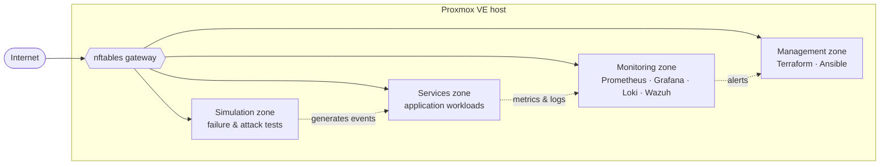

<!--
  GitHub Profile README
  Repository: YOUNES0101/YOUNES0101

  Before publishing:
    1. Replace YOUR-LINKEDIN-HANDLE in the Connect section.
    2. When SAIP is public, swap its "In progress" badge for a repository link.
    3. Add .github/workflows/snake.yml (provided separately) so the contribution snake renders.
-->

<div align="center">

<picture>
  <source media="(prefers-color-scheme: light)" srcset="https://capsule-render.vercel.app/api?type=waving&height=200&color=0:E6EDF3,50:B6D4E8,100:7FB3D5&text=Younes%20Chemmaoui&fontColor=0D1117&fontSize=44&fontAlignY=36&desc=Infrastructure%20%C2%B7%20Networking%20%C2%B7%20Security&descSize=17&descAlignY=57&animation=fadeIn" />
  
</picture>

<a href="https://github.com/YOUNES0101">
  
</a>

<p>
  
  
  
  
</p>

<sub>
  <a href="#whoami">whoami</a> &nbsp;·&nbsp;
  <a href="#projects">projects</a> &nbsp;·&nbsp;
  <a href="#methodology">methodology</a> &nbsp;·&nbsp;
  <a href="#toolbox">toolbox</a> &nbsp;·&nbsp;
  <a href="#activity">activity</a> &nbsp;·&nbsp;
  <a href="#connect">connect</a>
</sub>

</div>

---

<a id="whoami"></a>
## `$ whoami`

I like understanding what happens behind the scenes: how machines communicate, how infrastructure is put together, where security boundaries belong, and what happens when something goes wrong.

My work sits at the intersection of **Linux, networking, infrastructure automation, and cybersecurity**. I learn by building labs, breaking configurations on purpose, investigating the failures, and documenting what I find — because understanding *why* something works matters more to me than getting a tool to run.

```yaml
engineer:
  name: Younes Chemmaoui
  focus:     [Linux, Networking, Infrastructure Automation, Cybersecurity]
  building:  SAIP — Secure Autonomous Infrastructure Platform
  approach:  build → break → investigate → document
  principle: "If it isn't monitored, it isn't secured."
```

---

<a id="projects"></a>
## `$ ls -l ./projects`

<table>
<tr>
<td width="50%" valign="top">

<h3>🛡️ SAIP</h3>

<strong>Secure Autonomous Infrastructure Platform</strong>


A hands-on lab exploring how to deploy, isolate, secure, and monitor services on bare-metal Proxmox — treated like production, not a sandbox.

- **Network** — segmented zones behind an nftables gateway
- **Provisioning** — reproducible infrastructure with Terraform
- **Hardening** — Linux configuration as code with Ansible
- **Observability** — metrics, logs, and SIEM alerting
- **Validation** — controlled failure and attack simulations

<strong>Core stack</strong><br/>
`Proxmox` `Linux` `Terraform` `Ansible` `nftables` `Wazuh` `Prometheus` `Grafana` `Loki`

</td>
<td width="50%" valign="top">

<h3>🔥 Firewall Security</h3>

<strong>Java-based packet filtering application</strong>

<a href="https://github.com/YOUNES0101/Firewall-Security"></a>

A desktop application that captures live traffic, applies configurable filtering rules, and shows allowed and blocked packets in real time.

- **Capture** — live packet capture with Pcap4J
- **Rules** — pluggable rule engine built on the Strategy pattern
- **Filtering** — by IP, port, protocol, and packet size
- **History** — traffic logs persisted to MySQL
- **Persistence** — Hibernate / JPA, containerized with Docker

<strong>Core stack</strong><br/>
`Java 21` `JavaFX` `Pcap4J` `Hibernate` `MySQL` `Docker`

</td>
</tr>
<tr>
<td colspan="2" valign="top">

<h3>🧪 Cybersecurity Portfolio</h3>

Hands-on exercises, investigations, technical notes, and lessons learned — the working notebook behind everything above.

<a href="https://github.com/YOUNES0101/cybersecurity-portfolio"></a>

</td>
</tr>
</table>

<details>
<summary><strong>🗺️ SAIP — architecture overview</strong></summary>
<br/>



<sub>Default-deny between zones; every allowed flow is explicit, logged, and monitored.</sub>

</details>

---

<a id="methodology"></a>
## `$ cat ./methodology`

<table>
<tr>
<td align="center" width="25%"><h3>🔧</h3><strong>Build</strong><br/><sub>Infrastructure as code, reproducible from scratch</sub></td>
<td align="center" width="25%"><h3>🔍</h3><strong>Understand</strong><br/><sub>Trace packets, read logs, learn why it works</sub></td>
<td align="center" width="25%"><h3>🛡️</h3><strong>Secure</strong><br/><sub>Segment, harden, and enforce least privilege</sub></td>
<td align="center" width="25%"><h3>📈</h3><strong>Improve</strong><br/><sub>Break it on purpose, measure, iterate</sub></td>
</tr>
</table>

---

<a id="toolbox"></a>
## `$ cat ./toolbox`

<table>
<tr>
<td width="28%"><strong>Infrastructure & automation</strong></td>
<td></td>
</tr>
<tr>
<td><strong>Virtualization & network</strong></td>
<td>


</td>
</tr>
<tr>
<td><strong>Security & observability</strong></td>
<td>


</td>
</tr>
<tr>
<td><strong>Software development</strong></td>
<td></td>
</tr>
</table>

---

<a id="activity"></a>
## `$ git log --stat`

<div align="center">


<picture>
  <source media="(prefers-color-scheme: dark)" srcset="https://raw.githubusercontent.com/YOUNES0101/YOUNES0101/output/github-snake-dark.svg" />
  <source media="(prefers-color-scheme: light)" srcset="https://raw.githubusercontent.com/YOUNES0101/YOUNES0101/output/github-snake.svg" />
  
</picture>

</div>

---

<a id="connect"></a>
<div align="center">

## `$ ssh younes@connect`

<a href="https://github.com/YOUNES0101"></a>
<a href="https://www.linkedin.com/in/YOUR-LINKEDIN-HANDLE/"></a>

<br/><br/>

<sub><code>Build it. Understand it. Secure it. Improve it.</code></sub>


</div>
